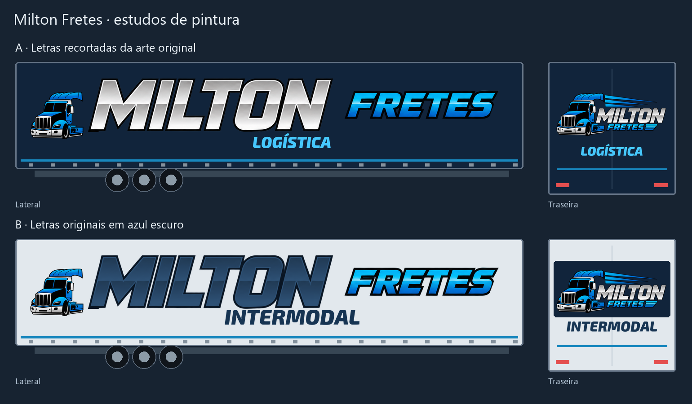

# Milton Fretes para ETS2

Leve a frota **Milton Fretes** para a estrada no Euro Truck Simulator 2. O mod reúne pinturas da empresa para caminhões e carretas, cargas rápidas, veículos do tráfego e letreiros.

*A identidade Milton Fretes nas carretas do mod.*

## O que vem no mod

- **Logística:** identidade azul-marinho.
- **Intermodal:** identidade grafite.
- Pinturas para caminhões e diferentes carrocerias de carreta.
- Carretas de cargas rápidas, veículos no tráfego e letreiros da empresa.
- Frases e detalhes que variam conforme a carroceria.

## Instalar ou atualizar pelo launcher

1. Baixe e abra o [Milton Fretes Launcher para Windows](https://github.com/andreltcarvalho/milton-fretes-ets-mod/releases/download/launcher-v1.1.0/milton-fretes-launcher.exe).
2. Aguarde a verificação da versão publicada no GitHub.
3. Com o ETS2 fechado, clique em **Instalar mod** ou **Atualizar mod**. Se a pasta do jogo não for encontrada ou estiver em outro local, selecione-a em **Escolher…**; se necessário, abra o ETS2 uma vez para criar a pasta de dados.
4. Na primeira instalação, abra o perfil no jogo e ative **Milton Fretes skins** no **Gerenciador de Mods**.

O launcher usa `Documentos\Euro Truck Simulator 2` por padrão. Ele verifica o download antes de instalar e pode organizar cópias extras ou corrigir o nome do arquivo para `Milton_Fretes_skins.scs`. Quem ainda tiver `Milton Fretes skins.scs` será migrado automaticamente ao organizar ou atualizar. O próprio launcher também avisa quando há uma nova versão. As cópias guardadas ficam em `Milton Fretes backups`, ao lado da pasta `mod`.

## Jogar no Comboio

Todos os participantes precisam instalar e ativar o mod, usar a **mesma versão** e manter o arquivo com o nome `Milton_Fretes_skins.scs`. Confiram a versão na [release mais recente](https://github.com/andreltcarvalho/milton-fretes-ets-mod/releases/latest) antes de entrar na sessão.

## Instalação sem launcher

Prefere instalar manualmente? Consulte o [guia de instalação manual](docs/instalacao-manual.md), com os passos para baixar, copiar, renomear e ativar o arquivo.

---

Mod não oficial para Euro Truck Simulator 2, da SCS Software.

Para manutenção do projeto, consulte as [instruções de publicação e compilação](docs/desenvolvimento.md).
